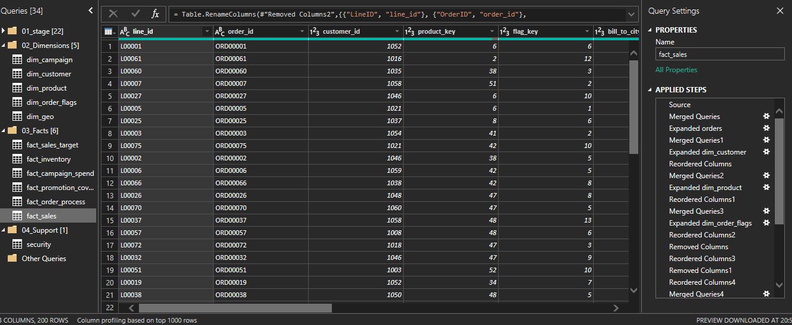
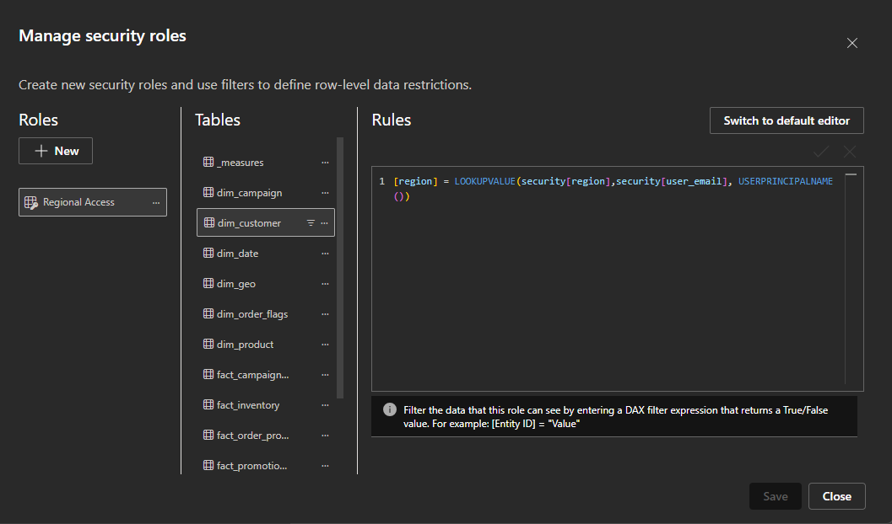
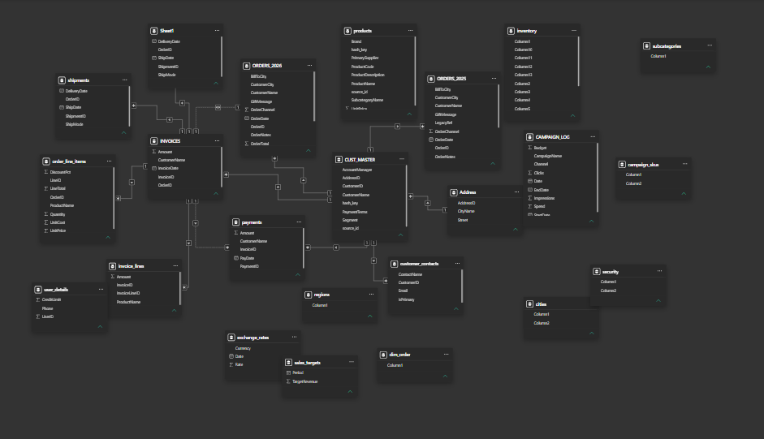
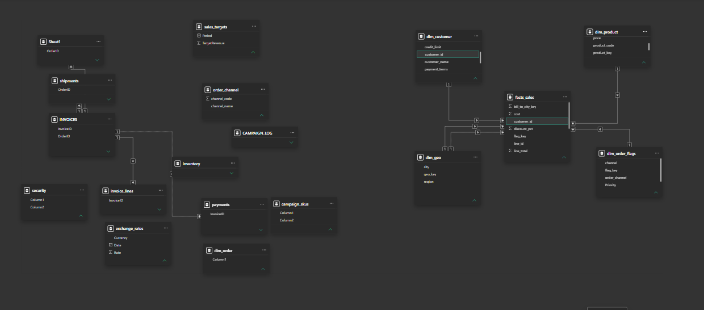
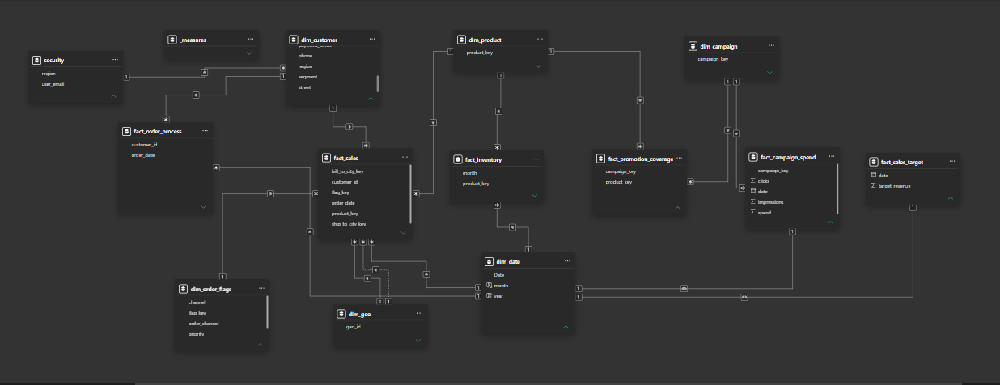

# Power BI Data Modelling Project

## Project Overview

This project documents my process of restructuring a Power BI data model, from its original state through transformation and organisation to a final model built around fact and dimension tables.

The work involved understanding the business context, examining the source data, cleaning and transforming tables, establishing naming standards, and applying star-schema design principles.

## Dataset Source

The dataset used in this project came from **Baraa on YouTube**. Credit goes to Baraa for providing the dataset used for this modelling exercise.

## My Approach

### Understanding the business and the data

After loading the data, I reviewed the initial model and realised that substantial work was needed before it could support the analysis I intended to build.

I examined the tables in Data view to understand their contents, how they related to the business processes, and what needed to change. Understanding the grain—what each row represented—was an important part of this process.

My reasoning was simple: the better I understood the data at the beginning, the better positioned I would be to avoid mistakes later.

### Transforming and organising the tables

I cleaned and restructured the data to build the tables needed for the model. This involved splitting, appending, and merging tables, removing unnecessary columns, and adding columns where needed.

I also organised the tables into folders and named columns consistently. Tables that were not needed in the final model were disabled from loading.

Throughout this stage, I worked with one principle in mind: **every column had to earn its place in the model.**

#### Power Query Transformation

The transformation process included merging and expanding queries, removing and reordering columns, standardising column names, and organising queries into staging, dimension, fact, and support groups.

### Building the fact and dimension structure

With a clearer understanding of the data and its grain, I built fact and dimension tables around the business processes represented in the dataset.

My design approach focused on star-schema principles, using shared dimensions rather than direct relationships between fact tables.

The final model contained **multiple fact tables connected through shared dimensions**, resulting in a **galaxy schema**.

The overall process brought together business understanding, data exploration, transformation, consistent standards, and relationship design.

### Creating row-level security

I also created **row-level security (RLS)** in the model as part of the project.

I implemented dynamic regional access using a security table and a DAX rule that identifies the current user and filters the model according to the region assigned to that user.

## Model Development

The screenshots document three stages of the project:

**Original Model → Work in Progress → Final Model**

They show the progression from the initial loaded tables to the structure developed through the modelling process.
### Original Model

This was the starting point after loading the source data. The tables still reflected the original source structure and required significant restructuring before they could support an effective analytical model.

### Work in Progress

At this stage, I had started separating the data into fact and dimension tables, cleaning the structure, and creating relationships around the business processes.

### Final Model

The final model contains multiple fact tables connected through shared dimensions, resulting in a galaxy schema designed to support different analytical processes without directly connecting fact tables to one another.

## Key Takeaway

My main lesson from this project was that data modelling starts before relationships are created.

Understanding the business, exploring the data, knowing the grain, and deciding what belongs in each table were central to my approach. The relationship diagram was the result of those decisions—not the starting point.
